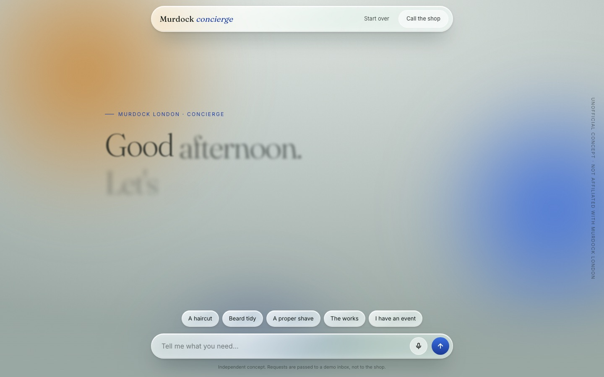

# Murdock Concierge

A booking concierge concept for a London barbershop. Talk or type what you need; it recommends services, handles groups and occasions, picks a shop and a preferred time, and saves the request.

**Live demo:** https://murdock-concierge.vercel.app



> **Unofficial concept.** This project is not affiliated with, endorsed by or connected to Murdock London. Prices and services come from the shop's public booking page. Requests are saved to a demo database, not sent to the shop, and are not real appointments.

## What it does

- **Guided and free-text intent:** quick chips or plain words ("wedding next week, beard trim") map to services.
- **Party size and occasions:** prices scale per guest; wedding, interview, date night, celebration, trip and ceremony get a short prep timeline.
- **Honest limits:** it never invents opening hours or availability. It asks for a preferred day and time, and tells the customer the shop confirms.
- **Take-home products:** optional, kept separate from the service total.
- **After booking:** reference number, add to calendar (`.ics`), copy summary.
- **Returning visitors:** name and contact details are remembered in the browser only (`localStorage`).
- **Voice mode:** a particle orb reacts to your microphone and to speech. Speech recognition and synthesis use the browser's Web Speech API, with an optional neural voice (below).

## How it works

| Part | Tech |
| --- | --- |
| Front end | One file: HTML, CSS and vanilla JavaScript. Liquid-glass styling with `backdrop-filter`, canvas particle orb, Web Audio analyser |
| Conversation | A small deterministic intent engine (keywords and a step machine). No language model is used for prices or bookings, so totals cannot be hallucinated |
| Storage | Supabase Postgres, one table, Row-Level Security: anonymous visitors can **insert only** |
| Hosting | Vercel (static site plus one serverless function) |

### Data and security notes

- The Supabase URL and `anon` key in `index.html` are public by design. Safety comes from RLS: the `anon` role has `INSERT` only, and column checks limit field lengths and email format. See [`supabase/schema.sql`](supabase/schema.sql).
- Never put a `service_role` key in this repository.
- Anyone can submit rows to the demo table, so treat it as untrusted input and rate limit before using this idea in production.

## Run it locally

```bash
git clone https://github.com/haliyu280-source/murdock-concierge.git
cd murdock-concierge
python3 -m http.server 4173
```

Open http://localhost:4173. With no Supabase configured, requests are stored in your browser only.

### Use your own Supabase project

1. Create a project and run `supabase/schema.sql` in the SQL editor.
2. Put your project URL and `anon` key in the `CFG` constant near the top of the script in `index.html`.

### Optional: human-sounding voice

Browser voices vary by device. For a natural voice, deploy to Vercel and set `OPENAI_API_KEY` (and optionally `TTS_VOICE`) as environment variables. The `/api/tts` function proxies a text-to-speech request, limits input to 560 characters and 40 requests per hour per IP, and the page falls back to the best browser voice when it is not configured.

## Limitations

- Availability is not checked. The real shop's booking system is not public.
- Voice recognition needs Chrome, Edge or Safari and microphone permission.
- Single-file front end for easy review; a production version would split modules and add tests.

## Licence

MIT. See [LICENSE](LICENSE).
